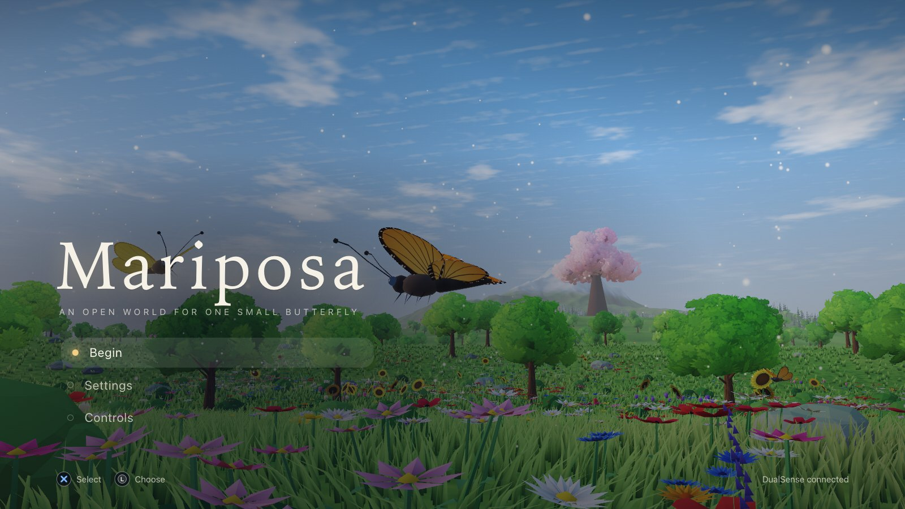
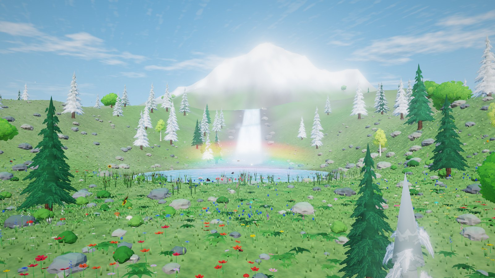
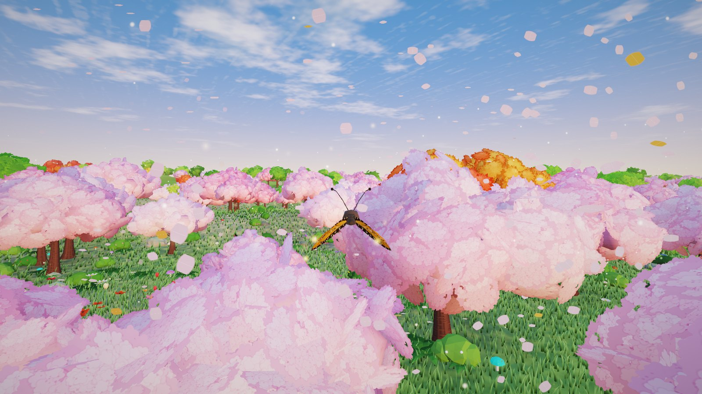
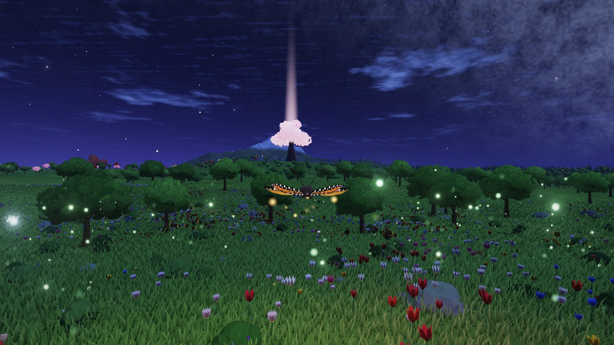
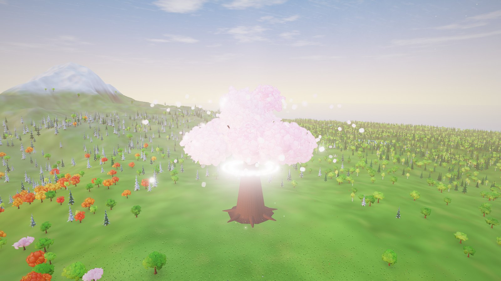

# Mariposa

An open world for one small butterfly. Made for the PS5 DualSense controller, and it plays with a keyboard and mouse
too. It runs in the browser, works offline, and the whole game is a single HTML file.

**Play it here: https://joymadhu49.github.io/mariposa/**



Fly across a 4 km island of meadows, blossom groves, lavender fields, mossy forest, a mirror lake, alpine heights,
maple hollows and a sunset shore. Sip nectar, spread pollen between flowers, discover twelve landmarks, gather ninety
six dew stars and wake the Heartbloom, the giant tree at the centre of the island.

Nothing is downloaded. The terrain, trees, flowers, butterflies, weather, music and sound are all generated in code.

| | |
| --- | --- |
|  |  |
|  |  |

## Play

Open the link above, or download `mariposa.html` from this repository and open it in a Chromium based browser (Chrome,
Brave, Edge) or Safari.

With a DualSense, connect it by USB or Bluetooth and press any button so the browser picks it up. Rumble needs a
browser that supports gamepad vibration. With a keyboard, just start: the prompts on screen follow whichever device you
touched last.

Your progress is saved in the browser (local storage) as you play, and Continue picks up where you left off. If the
title screen says the sound is off, click once or press a key. Browsers keep the sound muted until you do.

## Controls

| Action | DualSense | Keyboard and mouse |
| --- | --- | --- |
| Fly | Left stick | W A S D |
| Look | Right stick | Arrow keys, or click the game and move the mouse |
| Climb | Cross (hold) | Space |
| Dive | L2 (analog) | C or Ctrl |
| Boost | R2 (analog) | Shift |
| Sip nectar (hold near a flower) | Circle | E |
| Pulse (reveals dew stars) | Square | F |
| Hover | L1 | Q |
| Glide and recover | R1 | G |
| Recenter camera | R3 | R |
| Camera zoom | Directional pad up and down | [ and ] |
| Barrel roll | Directional pad left and right | , and . |
| Photo mode | Triangle | P |
| Map | Create | M or Tab |
| Journal | Touchpad click | J |
| Pause | Options | Esc |

Menus use the directional pad or left stick, Cross to choose and Circle to go back. The full layout is also on the in game
Controls screen.

## What to do

- Fly anywhere. There are no fail states. Boosting and climbing use energy, and it refills as you glide, ride warm
  thermals, collect dew stars or sip nectar.
- Sip from flowers to gather pollen, then sip a different species to cross pollinate and grow new blooms.
- Discover 12 landmarks across the eight regions and collect 96 dew stars (use the pulse to see them).
- Unlock new wings (Blue Morpho, Swallowtail, Glasswing, Luna Moth and Aurora Wing) and wear them from the Journal.
- Bring the island to full bloom, then fly to the Heartbloom for the finale.
- Take pictures in photo mode. There are five filters, and the image downloads as a PNG.

Time of day drifts slowly (Settings, Time of day). Weather comes and goes: haze, drizzle, showers and rainbows.

Small things to look for: the shadow on the Sundial Stones follows the real sun, and noon points at the north mark.
Skyreach Falls hangs a rainbow in its spray when the sun is low behind you. It snows on the heights.

## Settings

Graphics defaults to Auto and adjusts the render resolution to hold the frame rate. Low removes MSAA and bloom for
older machines. Reduce motion, guidance hints, stick dead zone, look speed, invert look and vibration are all in
Settings.

## Browser support

Needs WebGL2. Tested in Chromium and in WebKit (the Safari engine). On the Mac it was built on it runs above 100 frames
per second at 1080p. Firefox is untested, and its gamepad mapping on macOS is not supported.

## How it is built

Three.js with custom shaders and no assets, bundled into one file by esbuild.

- Terrain is an instanced CDLOD mesh drawn in one call, on a 1024 by 1024 height map generated at load time.
- Grass is a GPU lattice around the camera. Flowers, props and around twenty thousand trees stream in by cell.
- Lighting, fog, wind and clouds come from one shared set of uniforms, so the whole world shares the same sky.
- Post processing is an MSAA scene pass, bloom and a grade shader.
- Music is generated with Web Audio: pentatonic pads and bells on a convolution reverb, with layered ambience.
- Input reads the Gamepad API with radial dead zones, analog triggers and dual rumble.

Source layout: `src/world` (island generation), `src/render` (shaders, terrain, grass, trees, flowers, sky, water,
post), `src/game` (flight model, camera, weather, progress), `src/core` (input, audio), `src/ui` (HUD, menus,
journal, map).

## Build from source

```
pnpm install
pnpm run dev       # dist/mariposa.html, unminified
pnpm run release   # minified, also writes mariposa.html and index.html in the repo root
```

`mariposa.html` and `index.html` are the same file. `index.html` is there so GitHub Pages can serve the game at the
root of the site.

## Testing

`tools/` holds Playwright scripts that drive the game with a simulated DualSense (`tools/fakepad.js`) and step time
deterministically. Build first, then run them from the repo root. They need Playwright's browsers
(`pnpm exec playwright install chromium webkit`), and they are tuned for a Mac with a real GPU.

```
node tools/e2e.mjs        # controller: title, flight, sipping, pollination, map, photo, disconnect, save
node tools/e2e2.mjs       # discoveries, stars, unlocks, finale, continue
node tools/kbtest.mjs     # keyboard and mouse path
node tools/phototest.mjs  # photo mode: every filter downloads a real PNG at full resolution
node tools/loadbar.mjs    # loading screen fill at 0, 50 and 100 percent
node tools/savetest.mjs   # damaged or odd save data must never break boot
node tools/audiotest.mjs  # offline audio render, checks for NaN and clipping
node tools/presets.mjs    # every graphics preset and window sizes
node tools/soak.mjs 12    # 12 simulated minutes of flight, watches memory and frame time
node tools/fps2.mjs       # real frame rate in six spots (1920 x 1080)
node tools/webkit.mjs     # boots in WebKit across biomes and reports any errors
```

Set `BROWSER=webkit` to run e2e, e2e2, kbtest and savetest in WebKit instead of Chromium. The capture helpers (hero,
tod, landmarks, falls, sundial, snow, wx, finale, title, treeview, water, lmzoom and shots) write screenshots to a
temp folder, or to `MARIPOSA_SHOTS` if you set it. `node tools/shots.mjs` regenerates the pictures in this README.

## Third party software

The game bundles three.js, used under the MIT licence. See `THIRD_PARTY_NOTICES.md`.
